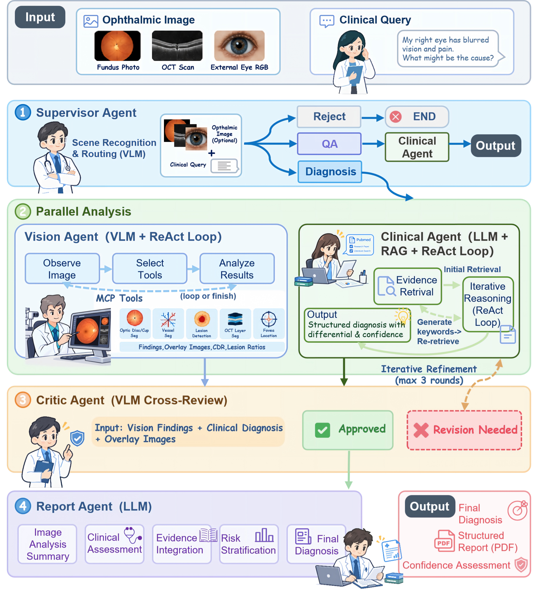
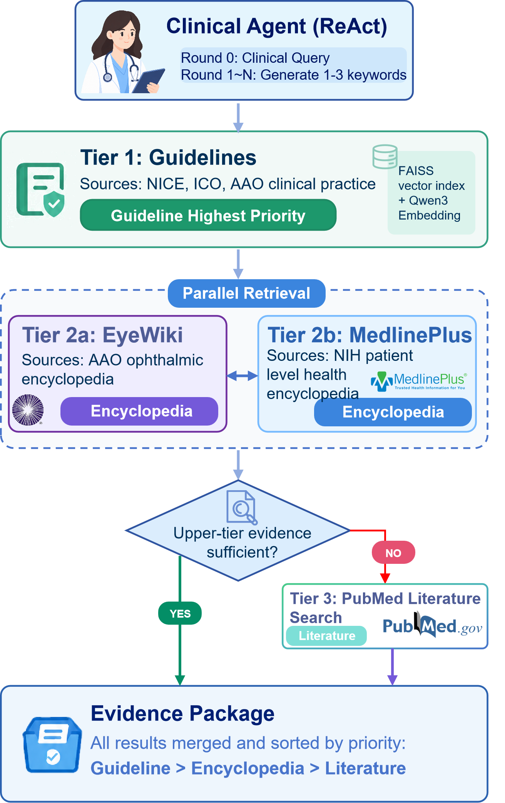
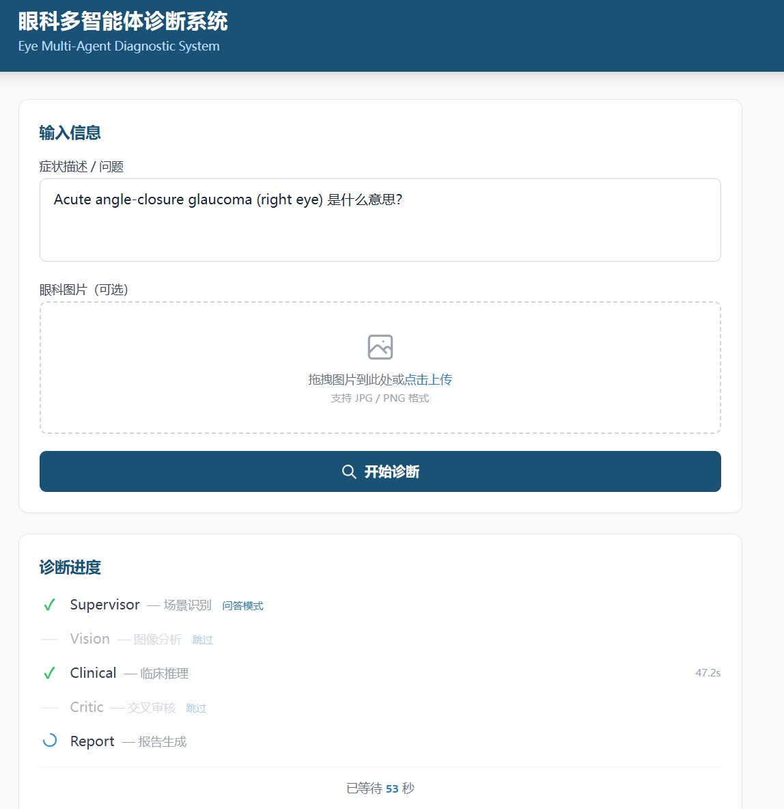
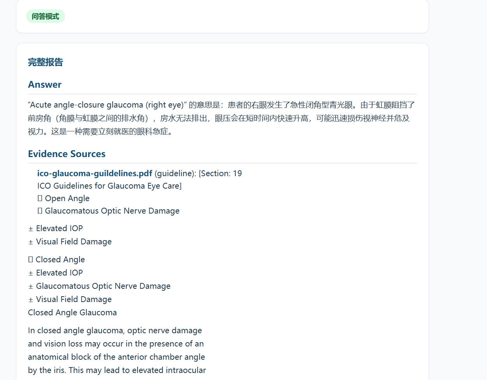
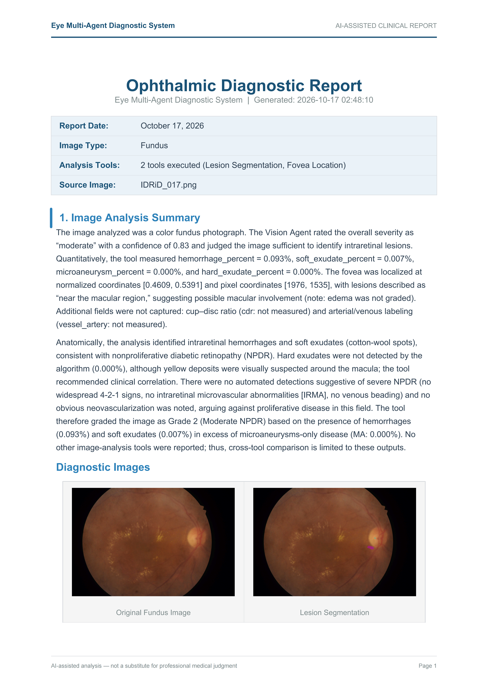
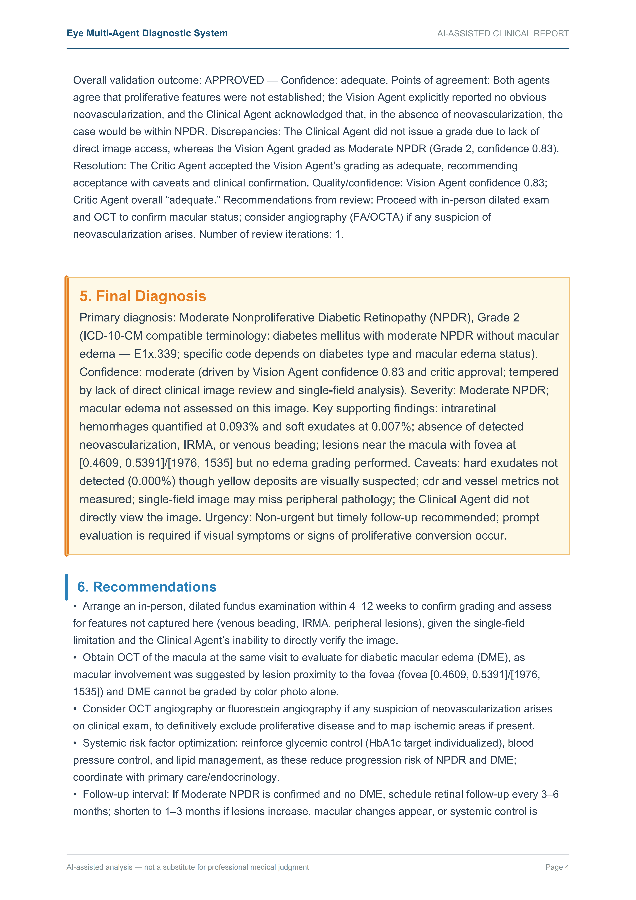
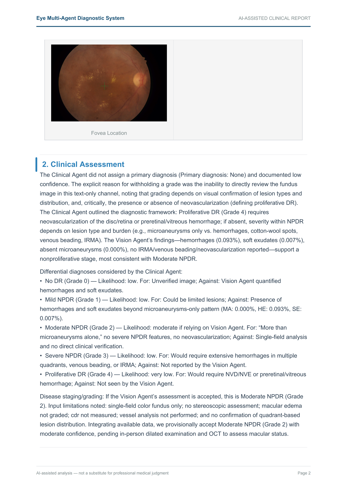
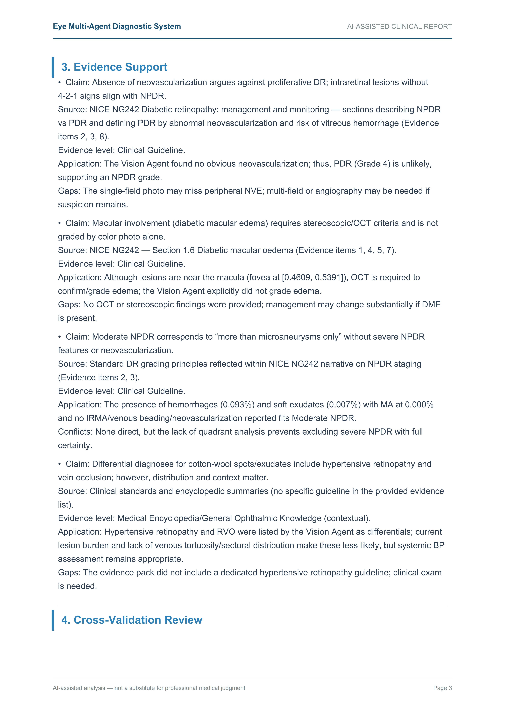
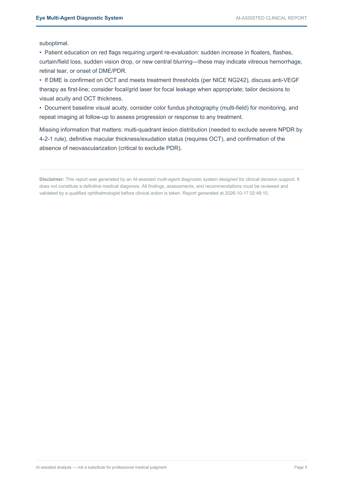

# 👁️ Eye-MultiAgent：基于 LangGraph 的眼科多智能体协同诊断系统

[]()
[]()
[]()
[](https://github.com/jimmybai666/eye-mcp)
[](https://github.com/jimmybai666/eye-multi-agent/tree/eval)

基于 **LangGraph** 状态图引擎，构建了一套眼科多智能体协同诊断系统。系统由 5 个专业化 Agent 组成，覆盖从图像接收到报告输出的完整诊断流程：

- **Supervisor** 负责场景路由，将请求分发至诊断、问答或拒绝管线
- **Vision Agent** 通过 MCP 协议调用眼科专用分割模型（视盘视杯分割、病灶检测、血管分割等），获取量化影像指标
- **Clinical Agent** 基于分层 RAG 系统（临床指南 > 医学百科 > PubMed 文献）进行循证推理
- **Critic Agent** 交叉比对视觉分析与临床推理的结论，发现矛盾时触发修正循环
- **Report Agent** 整合全部上游输出，生成结构化诊断报告（Markdown + PDF）

其中 Vision 与 Clinical 采用**并行执行**策略，在 Critic 节点汇合，兼顾诊断效率与多源信息融合。

> **动机**：我们在前期工作 [OphthaVLM-Eval](https://github.com/jimmybai666/eye-multi-agent/tree/eval) 中对 5 个视觉语言模型（VLM）进行了零样本眼科诊断评测，发现 VLM 存在三类系统性瓶颈：**缺乏定量化分析能力**（如无法测量杯盘比 CDR）、**细微病理特征识别不足**（如微动脉瘤、IRMA）、**疾病严重程度分级困难**（如 DR 4-2-1 rule）。Eye-MultiAgent 的设计初衷是通过多智能体协作 + 专业化工具 + 循证医学证据检索，系统性地弥补这些不足。

## 📑 目录

- [🏗️ 系统架构](#️-系统架构)
- [📁 项目结构](#-项目结构)
- [🛠️ 快速开始](#️-快速开始)
- [📊 评测结果](#-评测结果)
- [🖥️ 结果展示](#️-结果展示)
- [🔍 错误案例分析](#-错误案例分析)
- [🛡️ 工程兜底策略](#️-工程兜底策略)
- [🚀 可优化方向](#-可优化方向)
- [⚠️ 免责声明](#️-免责声明)
- [🙏 致谢与声明](#-致谢与声明)


## 🏗️ 系统架构



<p align="center">Eye-MultiAgent 系统架构与诊断流程</p>

### 🔄 整体流程

系统采用 **LangGraph** 构建状态图（StateGraph），共 5 个 Agent 节点，3 条执行管线：

| 管线 | 触发条件 | 执行路径 |
|:-----|:---------|:---------|
| **Diagnosis** | 用户上传眼科图像 + 症状描述/诊断请求 | Supervisor → [Vision + Clinical]（并行）→ Critic → Report → END |
| **QA** | 纯文本眼科知识问答 | Supervisor → Clinical → END |
| **Reject** | 非眼科相关请求 | Supervisor → END |

### 🤖 五个 Agent

| Agent | 模型类型 | 职责 | 核心能力 |
|:------|:---------|:-----|:---------|
| **Supervisor** | VLM | 场景识别与路由分发 | 判断图像有效性（眼底/OCT/裂隙灯/外眼 RGB 等相关眼科图像），路由至 diagnosis/qa/reject |
| **Vision Agent** | VLM + MCP | 眼科影像定量分析 | ReAct 循环（最多 3 轮工具调用），自动发现并调用 MCP 分割工具，输出量化 findings |
| **Clinical Agent** | LLM + RAG | 循证临床推理 | 迭代式证据检索，检索临床指南/EyeWiki/MedlinePlus/PubMed，输出结构化诊断 |
| **Critic Agent** | VLM | 交叉审核 | 比对 Vision 和 Clinical 的结论是否矛盾，审核证据充分性，必要时打回 Clinical 修正（最多 3 次迭代） |
| **Report Agent** | LLM | 诊断报告生成 | 整合所有上游输出，生成 6 节结构化英文报告 + PDF，包含 ICD 编码兼容的 Final Diagnosis |

### 💡 关键设计决策

**1. Vision 与 Clinical 并行执行**

两个核心分析 Agent 不存在数据依赖——Vision 分析图像，Clinical 检索证据，各自独立运行。并行设计将诊断延迟从串行的 T_vision + T_clinical 降至 max(T_vision, T_clinical)。汇合点在 Critic Agent，由其交叉比对两者的结论。

**2. MCP 工具自动发现**

Vision Agent 不硬编码工具名称，而是在运行时通过 `list_tools()` 动态发现 [eye-mcp](https://github.com/jimmybai666/eye-mcp) 工具服务器上可用的工具。新增分割模型只需在 eye-mcp 中注册，Vision Agent 即可自动调用，无需修改 Agent 代码。

eye-mcp 是一个独立的 MCP（Model Context Protocol）工具服务器，封装了 5 个眼科专用深度学习分割模型：

| 工具 | 模型架构 | 功能 | 输出 |
|:-----|:---------|:-----|:-----|
| `optic_disc_cup_seg` | SegFormer | 视盘视杯分割 + CDR 计算 | CDR 值、盘杯面积比、分割 overlay |
| `vessel_seg` | RIP-AV / PGNet | 视网膜动静脉分割 | 动脉/静脉/总血管面积比 |
| `lesion_seg` | VNet2d × 4 | 四类病灶检测（MA/HE/EX/SE） | 各类病灶面积占比、合并 mask |
| `fovea_locate` | ResNet34 + 热力图回归 | 黄斑中心凹定位 | 归一化 + 像素坐标 |
| `oct_segment` | UNet | OCT 语义分割（视网膜/脉络膜/IRC/MH） | 各层像素统计、分割 mask |

所有工具通过 stdio 传输协议暴露，支持 base64 图像输入，返回 JSON + 可视化 overlay（base64 PNG）。模型权重托管在 HuggingFace（[baibaidelaobai/jimmybai666_eye-mcp-weights](https://huggingface.co/baibaidelaobai/jimmybai666_eye-mcp-weights)）。具体实现见 [eye-mcp 仓库](https://github.com/jimmybai666/eye-mcp)。

**3. 分层证据检索**

Clinical Agent 的 RAG 系统按证据等级分层检索：**临床指南**（NICE、ICO、AAO 等）> **医学百科**（EyeWiki + MedlinePlus，并行检索）> **研究文献**（PubMed，仅在指南证据不足时触发）。检索采用 FAISS 向量索引 + Qwen3.7 Embedding，Clinical Agent 的 ReAct 循环每轮生成 1-3 条针对性检索 query。



<p align="center">Clinical Agent 分层证据检索架构</p>

**4. Critic 反馈循环**

当 Critic 发现 Vision 和 Clinical 之间存在实质性矛盾时，Clinical Agent 会被重新调用，Critic 的具体 issues 和 suggestions 会被注入到 Clinical 的输入中，引导其修正推理。最多迭代 3 次，防止死循环。

---

## 📁 项目结构

```
eye-multiagent/
├── app/
│   ├── agents/                # 5 个 Agent 实现
│   │   ├── supervisor/        #   场景识别与路由
│   │   ├── vision/            #   VLM + MCP 视觉分析
│   │   ├── clinical/          #   LLM + RAG 临床推理
│   │   ├── critic/            #   VLM 交叉审核
│   │   └── report/            #   报告生成
│   ├── graph/                 # LangGraph 状态图定义
│   ├── state/                 # AgentState 共享状态
│   ├── models/                # VLM / LLM / Embedding 工厂
│   ├── mcp/                   # MCP 客户端（连接 eye-mcp）
│   ├── rag/                   # 分层 RAG 系统
│   │   ├── guidelines/        #   临床指南（PDF → FAISS）
│   │   ├── eyewiki/           #   AAO EyeWiki
│   │   ├── medlineplus/       #   NIH MedlinePlus
│   │   └── pubmed/            #   PubMed 文献检索
│   ├── evaluation/            # 评测框架
│   └── utils/                 # PDF 报告生成、日志等
├── data/rag/                  # RAG 索引与缓存
├── datasets/                  # 6 个评测数据集
├── frontend/                  # Web UI（SSE 实时进度）
└── outputs/                   # 评测结果与诊断报告
```

---

## 🛠️ 快速开始

### 📋 环境要求

- Python 3.10+
- CUDA GPU（推荐，用于 MCP 工具模型推理加速）
- VLM/LLM API Key（GPT-5 或其他 OpenAI 兼容 API）
- [uv](https://github.com/astral-sh/uv) 包管理器（用于 eye-mcp 安装）

### 📦 Step 1：安装主项目

```bash
git clone https://github.com/jimmybai666/eye-multi-agent.git
cd eye-multiagent

# 安装 Python 依赖
pip install -r requirements.txt
```

### 🔑 Step 2：配置环境变量

```bash
cp .env.example .env
```

编辑 `.env` 文件，填入以下配置：

```env
# VLM / LLM API 配置（GPT-5 或兼容接口）
GPT_API_URL=https://your-api-endpoint
GPT_API_KEY=your-api-key

# Embedding 模型（用于 RAG 检索）
EMBEDDING_API_URL=https://your-embedding-endpoint
EMBEDDING_API_KEY=your-embedding-key
```

### 🔧 Step 3：安装 MCP 工具服务器

```bash
# 克隆 eye-mcp（与 eye-multiagent 同级目录）
cd ..
git clone https://github.com/jimmybai666/eye-mcp.git
cd eye-mcp

# 安装依赖
uv sync
```

### 📚 Step 4：构建 RAG 索引

```bash
cd ../eye-multiagent

# 一键构建所有知识库索引（临床指南 + EyeWiki + MedlinePlus + PubMed）
python scripts/build_all_indices.py
```

### 🚀 Step 5：启动服务

```bash
python -m app.main
# 访问 http://localhost:8000
```

### 🧪 运行评测

```bash
python -m app.evaluation.eval_agent --model agent_gpt5
```

---


## 📊 评测结果

### 🧪 评测方法

**为什么需要 Adapter？** 多智能体 Pipeline 的输出是一份完整的 Markdown 结构化诊断报告（含 6 个章节），而标准化评测需要将输出与 Ground Truth 标签（如 "GLAUCOMA"、"Grade 2"）逐一对比。报告文本无法直接用于分类评测，因此需要一个 Adapter 层完成两件事：**驱动 Pipeline 执行** 和 **从报告中提取分类标签**。

```
  眼科图像 + 症状描述/诊断请求
                ↓
┌─────────────────────────────────────────────────────────────────┐
│                        Adapter                                  │
│                                                                 │
│  模型热切换（Registry 替换 + cache 清除）                          │
│          ↓                                                      │
│  MCP 全局长连接（单次启动，全程复用）                                │
│          ↓                                                      │
│  完整 Pipeline: Supervisor → [Vision ∥ Clinical] → Critic → Report│
│          ↓                                                      │
│  Markdown 结构化报告（6 章节）                                     │
│          ↓                                                      │
│  Judge LLM 从 Final Diagnosis 提取分类标签                        │
│                                                                 │
└─────────────────────────────────────────────────────────────────┘
                            ↓
                  标签 vs Ground Truth → Accuracy
```

**Adapter 具体做了什么：**

1. **模型热切换**：所有 Agent 代码内部调用 `get_vlm("gpt5")`，Adapter 通过替换 Registry 中 `"gpt5"` 条目的模型配置 + 清除 `lru_cache`，实现零侵入的模型切换（如切到 Qwen），Agent 代码无需任何修改
2. **MCP 全局长连接**：正常流程中 Vision Agent 每次调用都会启动 MCP 子进程并加载模型权重。评测数据集时，Adapter 在评测开始前启动一次 MCP 子进程（`warmup_mcp`），通过 monkey-patch 让所有 Vision Agent 复用同一个 session，避免重复启动开销
3. **Pipeline 执行**：每张图片走完整管线（Supervisor → Vision + Clinical 并行 → Critic → Report），无需启动 HTTP 服务，直接在进程内调用 `graph.astream()`，同时记录逐节点耗时和原始输出
4. **Judge 标签提取**：从报告中截取 Final Diagnosis 段落，用一次轻量 LLM 调用提取分类标签。比正则更可靠——LLM 能理解 "no glaucomatous damage" → NON-GLAUCOMA、"mild NPDR" → Grade 1 等语义映射
5. **断点续跑**：支持 checkpoint resume，每张图片结果实时保存，评测中断后从上次位置继续

### 📈 结果对比

在 6 类眼科图像诊断任务上，对比 **Eye-MultiAgent（GPT-5 驱动的多智能体 Pipeline）** 与 **GPT-5 纯 VLM 零样本基线**：

| 任务 | 缩写 | 数据集 | 图像模态 | 类别数 | Baseline (GPT-5) | Agent (GPT-5) | 增益 |
|:-----|:-----|:-------|:---------|:-----:|:----------------:|:-------------:|:----:|
| 白内障检测 | CT | Cataract Dataset | 眼部 RGB | 2 | 93.0% | **100.0%** | +7.0 |
| 年龄相关性黄斑变性检测 | AMD | ADAM | 眼底彩照 | 2 | 66.7% | **80.0%** | +13.3 |
| 青光眼检测 | GL | REFUGE2 | 眼底彩照 | 2 | 66.2% | **75.0%** | +8.8 |
| 黄斑水肿风险评估 | ME | IDRiD | 眼底彩照 | 3 | 63.3% | **66.7%** | +3.4 |
| 糖尿病视网膜病变分级 | DR | IDRiD | 眼底彩照 | 5 | **46.7%** | 43.3% | -3.4 |
| 黄斑裂孔分期 | MH | OIMHS | OCT | 4 | **25.0%** | 22.5% | -2.5 |
| **平均** | | | | | 60.2% | **64.6%** | **+4.4** |

### 📈 各任务分析

**优势任务（Agent > Baseline）：**

- **CT 100%（+7.0pp）**：外眼 RGB 图像特征明显，pipeline 的结构化推理流程和 Critic 审核有效提升了分类置信度
- **AMD 80%（+13.3pp）**：`lesion_seg` 检测到的硬性渗出和出血为 AMD 识别提供了量化依据，Clinical RAG 检索到 NICE AMD 指南进一步支持诊断
- **GL 75%（+8.8pp）**：`optic_disc_cup_seg` 提供的 CDR 量化测量是核心增益来源，弥补了纯 VLM 缺乏定量评估的短板
- **ME 66.7%（+3.4pp）**：`fovea_locate` 提供了黄斑坐标，`lesion_seg` 提供了病灶面积，但两者缺乏空间交叉分析，增益有限

**瓶颈任务（Agent ≤ Baseline）：**

- **DR 43.3%（-3.4pp）**：Grade 0/2 表现极佳，但 Grade 3（Severe NPDR）和 Grade 4（PDR）准确率较差。根因分析见下方
- **MH 22.5%（-2.5pp）**：Stage 3/4 全部判错，准确率略低于 Baseline。根因分析见下方

---

## 🖥️ 结果展示

### 🌐 Web UI

系统提供基于 FastAPI + 原生 HTML/JS 的 Web 前端，支持：

- **图像上传**：拖拽或点击上传眼科图像（眼底彩照、OCT、裂隙灯、外眼 RGB）
- **SSE 实时流式推理**：通过 Server-Sent Events 实时展示各 Agent 的执行进度，用户可以看到 Supervisor 路由结果、Vision 工具调用过程、Clinical 证据检索轮次、Critic 审核意见等中间状态
- **结构化报告展示**：最终报告以 Markdown 格式实时渲染，包含 6 个标准章节（Image Analysis Summary、Clinical Assessment、Evidence Support、Cross-Validation Review、Final Diagnosis、Recommendations）
- **PDF 下载**：一键下载排版好的 PDF 诊断报告
- **纯文本问答**：支持无图像的眼科知识问答（走 QA 管线）

**问答模式示例：SSE 实时进度推送**



<p align="center">Supervisor 路由至问答模式，Vision/Critic 自动跳过，Clinical Agent 实时检索证据</p>

**问答模式示例：回答与证据来源**



<p align="center">Clinical Agent 基于 ICO 青光眼指南和 EyeWiki 百科生成结构化回答</p>

### 📄 报告生成效果

Report Agent 输出的诊断报告包含以下结构：

```
## 1. Image Analysis Summary（Vision Agent 量化数据）
## 2. Clinical Assessment（Clinical Agent 诊断推理）
## 3. Evidence Support（RAG 检索的指南/百科/文献引用）
## 4. Cross-Validation Review（Critic Agent 交叉审核意见）
## 5. Final Diagnosis（ICD 编码兼容的最终诊断）
## 6. Recommendations（后续检查和治疗建议）
```

**DR Grading 报告示例（IDRiD_017，Moderate NPDR，Agent 正确判定 Grade 2）：**

<table>
<tr>
<td width="50%"><p align="center">Page 1：Image Analysis + MCP 工具输出</p></td>
<td width="50%"><p align="center">Page 4：Final Diagnosis + Recommendations</p></td>
</tr>
</table>

<details>
<summary>📖 查看完整报告（5 页）</summary>







</details>

---

## 🔍 错误案例分析

### 🩺 DR Grading：Grade 3/4 瓶颈

DR 是 Agent 唯一显著低于 Baseline 的任务（43.3% vs 46.7%）。Grade 0 和 Grade 2 表现极佳，瓶颈集中在 Grade 3（Severe NPDR，0/6）和 Grade 4（PDR，1/6）。逐案例分析定位到两层根因：

**1. MCP 工具覆盖不足 + VLM 视觉能力天花板**

当前 `lesion_seg` 只能检测 MA（微血管瘤）、HE（出血）、EX（硬性渗出）、SE（软性渗出）四类基础病灶，足以支撑 Grade 0-2 的分级。但 Grade 3 的诊断依据是 **ETDRS 4-2-1 规则**（四象限出血/MA、两象限静脉串珠、一象限 IRMA 满足任一即为 Severe NPDR），Grade 4 需要识别**新生血管（NV）**。这三类高级特征——NV、IRMA、静脉串珠——MCP 均无对应检测工具，Vision Agent 无法提供量化依据。

理论上 VLM 可以直接从图像中识别这些特征弥补工具缺口。为验证这一假设，我们设计了 Fusion 实验：将原始图片 + Vision findings + Clinical evidence + 完整 ETDRS 标准全部喂给 GPT-5 重判，结果 **11 个 Grade 3/4 错误案例全部仍被判为 Grade 2**——VLM 每次都报告 "no neovascularization, no venous beading, no IRMA"。这些微细病理特征在压缩后的眼底图上超出了当前 VLM 的识别能力。

这意味着仅靠 prompt 优化或 VLM 升级难以突破，需要从**工具层**补齐能力：新增 NV/IRMA 专用检测模型注册为 MCP 工具，让 Vision Agent 获得 Grade 3/4 特征的量化检测能力。

**2. 并行架构的信息融合限制**

Vision 和 Clinical 并行执行：Vision 有图像但缺乏分级知识，Clinical 有 RAG 检索到的完整 4-2-1 rule 但看不到图像。两者在 Critic 才汇合，此时 Vision 已锁定了 Grade 2 的结论。对 DR 这类需要深度跨模态融合的任务，可以考虑条件串行模式——让 Clinical 在看到 Vision 的量化 findings 后再结合 RAG 知识做分级判断。

### 🕳️ Macular Hole：任务难度超出当前视觉能力

MH 分期（Gass Stage 1-4）是 6 类任务中对图像理解要求最高的：不同分期之间的视觉差异极其细微，需要从单张 OCT B-scan 中识别裂孔形态、边缘特征、玻璃体牵拉状态等精细结构。这远超通用 VLM 和现有分割工具的能力边界——纯 VLM baseline（25%）与 Agent（22.5%）几乎一致，说明问题不在系统设计，而在视觉感知本身。

具体瓶颈有两层：

**1. 单切片信息不足**：OIMHS 数据集每眼包含数十张 B-scan，但评测中仅选取一张做分期判断。多数切片不经过 fovea 中心，无法观察到裂孔全貌。`oct_segment` 工具仅在部分切片检测到 MH 区域，其余切片上模型和工具都缺乏有效输入。

**2. 分割面积与分期无对应关系**：即便 `oct_segment` 检测到裂孔，其输出的面积占比与 Gass 分期之间不存在单调映射——Stage 2 的裂孔面积可能大于 Stage 3。分期的关键在于裂孔的**形态学特征**（全层 vs 板层、有无 operculum、边缘是否隆起），而非简单的面积统计。

这类任务更适合训练专用的 MH 分期分类模型（基于 OCT 数据做 Stage 1-4 分类），注册为 MCP 工具后让 Vision Agent 直接获取分期结果，而非依赖通用分割 + VLM 推理的间接路径。

### 💧 Macular Edema：MCP 缺少空间定位工具

ME Risk 分级的核心判断是**病灶与黄斑的空间关系**——同样的出血或渗出，在黄斑区外是 Risk 1（at risk），在黄斑区内是 Risk 2（edema present）。但当前 MCP 工具链没有提供这一能力：`lesion_seg` 输出全图病灶面积百分比，`fovea_locate` 输出黄斑中心坐标，两个工具各自独立，没有一个工具能将病灶 mask 与黄斑坐标做空间交叉分析。Vision Agent 看到的是 "EX 0.000%, HE 0.032%" + "fovea at (0.52, 0.48)"，无法判断这些病灶是否落在黄斑区域内。

这直接导致 Risk 1 vs Risk 2 的区分失败。此外，`lesion_seg` 在正常眼底上存在 0.003%-0.686% 的假阳性面积，使 Risk 0（正常）与 Risk 1（有 DR 征象但黄斑未受累）的边界进一步模糊。

解决路径明确：新增一个**黄斑区病灶空间分析工具**，融合 `fovea_locate` 坐标 + `lesion_seg` 像素级 mask，输出黄斑中心 500μm / 1000μm 半径内各类病灶的面积和分布，让 Vision Agent 直接获得空间定位信息。

---

## 🛡️ 工程兜底策略

医疗诊断系统对可用性要求极高——任何单点故障都不应导致整条管线崩溃。系统按 **API 层 → 图级别 → 节点级别 → Agent 内部 → 工具层** 五层纵深设计了完整的容错与降级机制。

### 🏰 核心防御：`_safe_node` 装饰器

每个 Agent 节点都被 `_safe_node()` 包裹，这是最关键的一层防线。当节点内部所有 try/except 都未能捕获的异常穿透时，`_safe_node` 捕获异常并返回预定义的 fallback state，管线继续执行：

| 节点 | 崩溃时行为 | 设计理由 |
|:-----|:----------|:---------|
| Supervisor | `route: "reject"` 安全终止 | 不确定时走最安全的拒绝路径 |
| Vision | 空 findings + unknown type | Clinical 仍可独立工作 |
| Clinical | `{"raw": "(unavailable)"}` | Report 可处理空文本 |
| Critic | `approved: True` 自动放行 | 宁可漏审也不阻塞出报告 |
| Report | 错误提示 markdown | 至少告知用户发生了什么 |

### 📉 渐进降级策略

```
MCP 子进程崩溃 → Vision Agent 回退到纯 VLM 分析（无量化数据）
       ↓ VLM API 也挂了
Vision 节点返回空 findings → Clinical 独立完成诊断
       ↓ Clinical 也挂了
Report 收到空输入 → 生成错误提示报告，管线正常结束
       ↓ PDF 生成失败
仅返回 Markdown 文本报告，前端仍可渲染
```

### 📋 各层防御摘要

| 层级 | 组件 | 故障场景 | 重试策略 | 降级行为 |
|:-----|:-----|:---------|:---------|:---------|
| API | `/diagnose` | 管线崩溃 | 无 | HTTP 500 + JSON 错误 |
| API | `/diagnose-stream` | 管线崩溃 | 无 | SSE error 事件 |
| Graph | `_safe_node` | 任何节点崩溃 | 无 | 预定义 fallback state |
| Agent | Supervisor VLM | API 错误 | 2 次 + 指数退避 | route: reject |
| Agent | Vision MCP | 连接失败 | 无 | 纯 VLM 分析 |
| Agent | Vision 工具 | 工具执行错误 | 3 次 + 退避 | error 标记 |
| Agent | Clinical 检索 | RAG 失败 | 无 | 零证据推理 |
| Agent | Critic VLM | API 错误 | 2 次 + 指数退避 | auto-approve |
| Agent | Report LLM | API 错误 | 2 次 + 退避 | 错误提示 markdown |
| Tool | MCP call | 工具异常 | 上层重试 | error dict |
| Tool | PDF 图片 | 文件缺失 | 无 | 跳过图片 |

### 🔐 JSON 解析三层防御

所有 LLM/VLM 输出解析使用统一的三层防御模式：**Markdown 代码块剥离 → 正则提取 JSON 对象 → `json.loads` + 字段验证**。解析失败时各 Agent 有不同的安全默认值——Supervisor 走 reject，Vision 保留原始文本，Clinical 提前出结论，Critic 保守不通过。

### 📐 设计原则

1. **永不崩溃**：从 API 到工具层，每层都有异常捕获
2. **偏向安全**：不确定时 Supervisor reject、Critic not approved
3. **偏向可用**：Critic API 崩溃时 auto-approve，不阻塞管线
4. **信息保留**：JSON 解析失败时保留原始文本 `{"raw": ...}` 而非丢弃
5. **指数退避**：所有重试带延迟，避免 API 限流时雪上加霜

---

## 🚀 可优化方向

### 🔧 MCP 工具优化

1. **新增黄斑区病灶空间分析工具**：融合 `fovea_locate` 坐标 + `lesion_seg` 的像素级 mask，输出黄斑中心 500μm / 1000μm 半径内各类病灶（EX/HE/MA/SE）面积及分布，直接解决 ME Risk 分级中 Risk 1 vs Risk 2 无法区分的核心瓶颈
2. **新增 NV/IRMA 检测工具**：基于 IDRiD 数据集训练轻量级新生血管（NV）和视网膜内微血管异常（IRMA）分割模型，注册为 MCP 工具，弥补 DR Grade 3/4 的检测缺口——这是当前 DR 准确率瓶颈的第一层根因
3. **OCT 智能切片选择**：对 MH 评估任务，在调用 `oct_segment` 前先自动筛选经过 fovea 中心的 B-scan 切片，避免在无裂孔信息的切片上做分期判断

### 🤖 智能体优化

4. **任务感知 Prompt 动态注入**：根据 Supervisor 识别的诊断任务类型，为 Vision Agent 动态注入任务特定的检查清单（如 DR 任务加入 ETDRS 4-2-1 rule、GL 任务加入 ISNT rule），而非使用通用 prompt
5. **自适应执行拓扑**：根据 Supervisor 识别的任务复杂度，动态切换 Agent 编排策略——简单二分类任务（CT、AMD）保持 Vision ∥ Clinical 并行以降低延迟，多级分级任务（DR、ME）自动切换为 Vision → Clinical 串行拓扑，让 Clinical 在获得 Vision 量化 findings 后再结合 RAG 知识做分级推理，实现效率与跨模态融合深度的自适应平衡
6. **Human-in-the-Loop**：在 Critic 审核后、Report 生成前插入人工审核节点，医生可查看 Vision findings + Clinical 推理 + Critic 意见，确认或修正诊断结论后再生成最终报告。LangGraph 的 `interrupt` 机制原生支持此模式，无需改动现有 Agent 代码
7. **多智能体协同后训练**：当前各 Agent 的基座模型独立训练，彼此不了解上下游的输出风格和期望格式。可利用评测中积累的完整 Pipeline trace（Vision findings → Clinical reasoning → Critic feedback → Report）作为偏好数据，对各 Agent 做协同微调——让 Vision 学会输出 Clinical 更容易消化的 findings，让 Clinical 更好地响应 Critic 的修正意见，让 Critic 更精准地定位跨模态矛盾。类似多智能体 RLHF 中的联合策略优化，以诊断正确性作为 reward signal

### 🧠 模型层优化

8. **开源模型替代 + 领域微调**：当前系统依赖 GPT-5 等闭源 API，推理成本高且无法定制。可迁移至开源 VLM/LLM（如 Qwen-VL、LLaMA 系列）作为各 Agent 基座，配合眼科领域 LoRA 微调，在降低 API 调用成本的同时提升对 NV、IRMA 等微细病理特征的识别能力——Fusion 实验已验证通用 VLM 零样本能力的天花板
9. **多模态联合输入**：支持同一患者的多张图像同时输入（双眼对比、OCT + Fundus 联合），让 Vision Agent 在单次分析中获得跨模态信息，而非当前的单图单次推理
10. **纵向随访追踪**：支持同一患者不同时间点的图像对比，自动识别病灶变化趋势（如 DR 进展、黄斑水肿消退），为慢性眼病的长期管理提供量化依据


---

## ⚠️ 免责声明

本系统仅用于学术研究目的，不构成任何形式的临床诊断建议。系统输出不能替代专业眼科医师的判断。如有眼部健康问题，请咨询专业医疗人员。

---

## 🙏 致谢与声明

- **框架与协议**：LangGraph（多智能体编排）、Model Context Protocol / MCP（工具调用协议）
- **评测数据集**：IDRiD（DR 分级 + ME 风险评估）、REFUGE2（青光眼检测）、ADAM（AMD 检测）、OIMHS（黄斑裂孔 OCT 分期）、Cataract Dataset（白内障检测）
- **知识来源**：NICE / ICO / AAO 临床指南、AAO EyeWiki、NIH MedlinePlus、PubMed

以上数据集和第三方资源均遵循其各自的许可协议，仅用于学术研究。如有侵权请通过 [Issue](https://github.com/jimmybai666/eye-multi-agent/issues) 联系，我们将立即处理。
