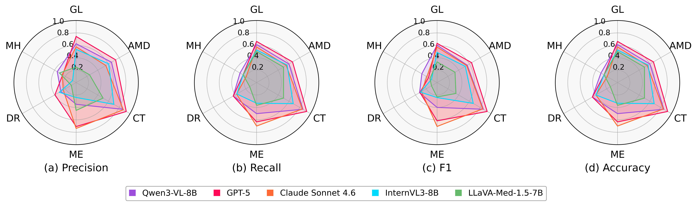
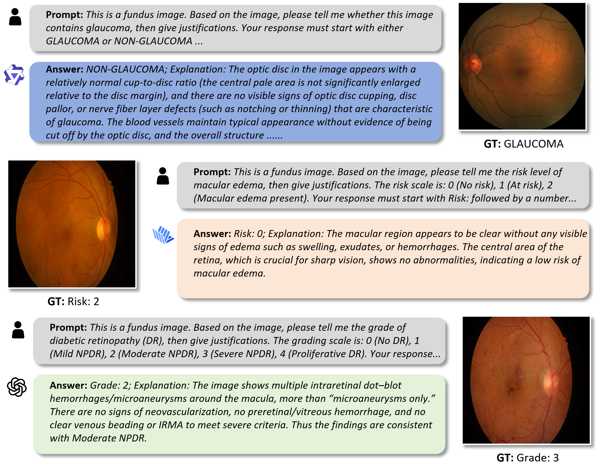
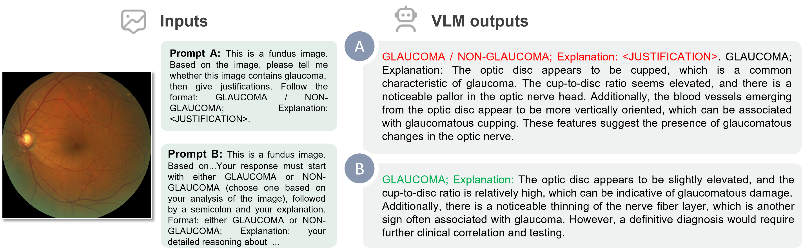

# 👁️ OphthaVLM-Eval：面向眼科诊断任务的视觉语言模型零样本评估
[]()
[]()
[]()
[]()

在 6 类眼科图像诊断任务上，零样本（Zero-shot）评估 5 个视觉语言模型（VLM）的临床推理能力，涵盖青光眼、糖尿病视网膜病变、黄斑裂孔等主流眼病。

> 本项目记录了完整的评估流程与提示词工程经验，希望能为眼科 AI 评估提供参考。


## 📊 评估结果可视化



---

## 🗂️ 评估任务与数据集

| 缩写 | 任务                   | 数据集           | 图像模态 | 类别数 | 样本数 |
|:-----|:----------------------|:----------------|:---------|:-----:|:-----:|
| GL   | 青光眼检测             | REFUGE2         | 眼底彩照  | 2     | 80    |
| MH   | 黄斑裂孔分期           | OIMHS           | OCT      | 4     | 52    |
| DR   | 糖尿病视网膜病变分级    | IDRiD           | 眼底彩照  | 5     | 30    |
| ME   | 黄斑水肿风险评估       | IDRiD           | 眼底彩照  | 3     | 30    |
| CT   | 白内障检测             | Cataract Dataset | 眼部RGB  | 2     | 100   |
| AMD  | 年龄相关性黄斑变性检测  | ADAM            | 眼底彩照  | 2     | 60    |

---

## 🤖 评估模型

| 模型             | 参数量 | 开发方               | 部署方式                      |
|:-----------------|:-----:|:---------------------|:-----------------------------|
| GPT-5            | —     | OpenAI               | 官方 API（闭源）              |
| Claude Sonnet 4.6| —     | Anthropic            | 官方 API（闭源）              |
| Qwen3-VL-8B     | 8B    | 阿里巴巴（通义实验室） | API + 开源自部署              |
| InternVL3-8B    | 8B    | 上海 AI Lab          | vLLM 自部署（AutoDL）         |
| LLaVA-Med-1.5-7B| 7B    | Microsoft            | FastChat 自部署（AutoDL）     |

---

## ⚙️ 评估方法

采用 **Zero-shot** 评估：不对模型进行任何微调或 few-shot 示例，仅通过文本 prompt 引导模型对输入图像做出诊断。

### 流程

1. **环境搭建**：本地运行评估脚本，通过 API 调用各模型
   - 闭源模型（GPT-5、Claude Sonnet 4.6、Qwen3-VL-8B）→ 直接调用云端 API
   - InternVL3-8B → AutoDL 部署 vLLM，暴露 OpenAI 兼容接口
   - LLaVA-Med-1.5-7B → AutoDL 部署 FastChat Worker，使用专有 API 端点
2. **逐样本推理**：对数据集中每张图像，拼接图像 + prompt 发送给模型
3. **答案解析**：用正则匹配从自然语言回答中提取分类标签
4. **结果统计**：计算各类指标并保存为 JSON

### 评估指标

| 指标            | 说明                        | 含义                                                                 |
|:----------------|:---------------------------|:---------------------------------------------------------------------|
| Accuracy        | 总体正确率                   | 所有样本中预测正确的比例，反映模型的整体表现                              |
| Macro Precision | 各类别精确率的算术平均        | 模型预测为某类时的准确程度，不受类别样本数影响，适合评估不平衡数据集           |
| Macro Recall    | 各类别召回率的算术平均        | 模型找出各类别真实样本的能力，每个类别权重相同，确保小类别不被忽视             |
| Macro F1        | 各类别 F1 分数的算术平均      | 精确率和召回率的调和平均，综合反映模型在各类别上的平衡表现                    |

> **为什么使用 Macro 平均？** 在医学诊断任务中，不同疾病类别的样本数量往往不平衡（如罕见病样本较少）。Macro 平均对每个类别赋予相同权重，确保模型在少数类别上的表现同样被重视，避免模型偏向多数类别。

---

## 📈 评估结果

### Accuracy 总览

| 模型              | GL    | MH        | DR        | ME        | CT        | AMD       | 平均      |
|:------------------|:-----:|:---------:|:---------:|:---------:|:---------:|:---------:|:---------:|
| GPT-5             | **66.2%** | 25.0%     | 46.7%     | 63.3%     | **93.0%** | **66.7%** | **60.2%** |
| Qwen3-VL-8B      | 61.3% | **30.8%** | **46.7%** | 50.0%     | 86.0%     | 60.0%     | 55.8%     |
| Claude Sonnet 4.6 | 57.5% | 19.2%     | 40.0%     | **70.0%** | 85.0%     | 55.0%     | 54.5%     |
| InternVL3-8B     | 52.5% | 25.0%     | 40.0%     | 33.3%     | 68.0%     | 56.7%     | 45.9%     |
| LLaVA-Med-1.5-7B | 50.0% | 25.0%     | 13.3%     | 36.7%     | 50.0%     | 50.0%     | 37.5%     |


- **CT（白内障）** 是最简单的任务，所有模型表现最好（GPT-5 达 93%）
- **MH（黄斑裂孔分期）** 和 **DR（DR分级）** 是最难的多分类任务
- 闭源大模型（GPT-5、Sonnet）总体优于开源小模型，推测与模型参数量及训练数据规模有关，可能是受到了参数量的影响

### 错误案例分析

尽管视觉语言模型（Vision-Language Models, VLMs）在眼科图像理解任务中展现出较强的零样本能力，但在细粒度医学影像分析方面仍存在一定局限。本项目选取三个具有代表性的失败案例，用于分析当前 VLM 在眼科诊断任务中的典型失败模式。



#### 1. 缺乏定量化评估能力（Lack of Quantitative Assessment）

青光眼诊断高度依赖视神经结构分析，包括杯盘比（Cup-to-Disc Ratio, C/D ratio）、神经视网膜盘沿变化以及视网膜神经纤维层（RNFL）缺损等指标。模型对该病例做出了错误判断，其解释主要停留在定性描述层面，缺乏对关键结构指标的量化评估。

**主要失败模式：**

- 能够理解基本解剖结构
- 缺乏定量化临床指标分析
- 难以捕捉细微结构异常

#### 2. 细微病理特征识别不足（Limited Detection of Subtle Pathological Features）

黄斑水肿风险评估需要识别黄斑区域细微异常，包括视网膜增厚、硬性渗出以及其他与液体积聚相关的表现。模型对该病例做出了错误判断，表明当前 VLM 对于不明显或早期病理变化的感知能力仍有限。

**主要失败模式：**

- 对明显异常具有一定识别能力
- 对细微病变敏感性不足
- 难以发现早期或轻度病理改变

#### 3. 疾病严重程度分级能力不足（Difficulty in Disease Severity Grading）

糖尿病视网膜病变（Diabetic Retinopathy, DR）的分级需要综合考虑病灶类型、数量以及分布范围，并依据临床标准区分不同严重程度。模型虽能识别病变相关表现，但未能准确判断疾病严重程度，说明当前 VLM 在依赖临床标准的细粒度疾病分级任务中仍存在不足。

**主要失败模式：**

- 能够识别疾病相关视觉特征
- 难以区分相邻疾病等级
- 对病灶数量和严重程度判断不足

---

## ✏️ 提示词工程

提示词设计对模型输出质量和可解析性影响极大。以下是评估过程中遇到的核心问题及解决方案。

### 问题 1：格式化回复诱导（Format Imitation）

**现象**：prompt 中给出格式示例后（如 `GLAUCOMA / NON-GLAUCOMA`），模型倾向于直接复制该格式字符串作为回答，而非基于图像内容做出实际判断。

这是格式示例诱导问题，不是医学判断错误。



**解决**：重新设计提示词结构，移除可能引发格式模仿的斜杠分隔示例，改用更明确的指令式表达：

```
# Before (格式诱导)
This is a fundus image. Based on the image, please tell me whether this image 
contains glaucoma, then give justifications. Follow the format: GLAUCOMA / NON-GLAUCOMA; 
Explanation: <JUSTIFICATION>.
→ 模型可能直接回答 "GLAUCOMA / NON-GLAUCOMA"

# After (改进后的提示词)
This is a fundus image. Based on the image, please tell me whether this image 
contains glaucoma, then give justifications. Your response must start with either 
GLAUCOMA or NON-GLAUCOMA (choose one based on your analysis of the image), followed 
by a semicolon and your explanation. Format: either GLAUCOMA or NON-GLAUCOMA; 
Explanation: your detailed reasoning about the optic disc, cup-to-disc ratio, and 
nerve fiber layer.
```

**关键改进点：**
- 移除斜杠分隔的并列选项（`GLAUCOMA / NON-GLAUCOMA`），避免模型直接复制
- 使用 "either...or" 结构明确二选一的要求，并强调 "choose one based on your analysis"
- 将格式说明与选项内容分离，在格式部分仍使用 "either...or" 保持一致性
- 添加具体的医学推理要点（optic disc, cup-to-disc ratio, nerve fiber layer），引导模型关注关键特征

### 问题 2：示例内容偏差（Example Bias）

**现象**：prompt 中给出具体输出示例后，部分模型倾向于模仿示例的答案内容，而不是根据实际图片判断。

**解决**：完全移除所有示例，仅保留任务描述和输出格式要求：

```
# Before (有内容偏差)
Example: "GLAUCOMA; Explanation: The optic disc shows enlarged cupping..."
→ 模型倾向于输出 GLAUCOMA

# After (无示例)
Answer with either GLAUCOMA or NON-GLAUCOMA, then explain your reasoning.
```

### 问题 3：LLaVA-Med 的短 Prompt 策略

**现象**：LLaVA-Med 受限于上下文容量，在包含较复杂任务描述和额外约束信息的 prompt 下容易出现生成受限的问题。相比通用视觉语言模型，需要采用更加简洁、直接的提示策略以保证稳定推理。

**解决**：设计专用短 prompt，为模型留足生成空间：

```
# 通用模型 prompt → LLaVA-Med 空输出
This is a fundus image. Based on the image, please tell me whether this image 
contains glaucoma, then give justifications. Your response must start with either 
GLAUCOMA or NON-GLAUCOMA (choose one based on your analysis of the image), followed 
by ...

# LLaVA-Med 专用 prompt → 正常输出
Does this fundus image show glaucoma? Answer with GLAUCOMA or NON-GLAUCOMA, then 
explain your reasoning about the optic disc and cup-to-disc ratio.
```
